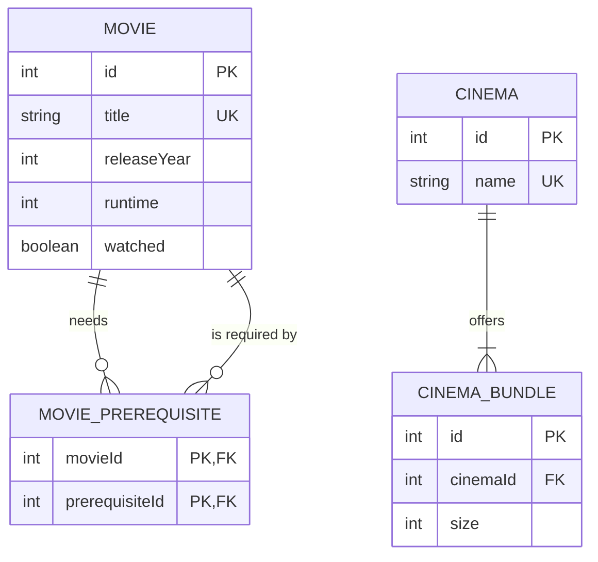

# Doomsday Ready

An MCU rewatch and watch-party planner built with React, Vite, NestJS and PostgreSQL. Choose a target movie to see its prerequisites in watch order. Mark films as watched to update the remaining runtime, or pick a cinema to find the fewest seat bundles for your group.

## Run with Docker

Start the three services from the project directory.

```sh
docker compose up --build
```

Open the [movie library](http://localhost:5173) or the [interactive API reference](http://localhost:3000/api-docs). Before the API starts, a setup service applies migrations, seeds empty catalogs and provisions a restricted database login. PostgreSQL keeps the catalog in a named volume. Run `docker compose down` to stop the app.

## Public hosting

The [Alwaysdata deployment guide](deploy/alwaysdata.md) runs the website and API together on a free personal hosting account with PostgreSQL. Set the website’s idle timeout to zero to keep it running between visits.

The [Northflank deployment guide](deploy/northflank.md) uses two always-on Sandbox services and a private PostgreSQL database. A GitHub Actions monitor can check the live API and its database connection every 15 minutes.

The [Oracle Cloud deployment guide](deploy/README.md) runs the full stack on one Always Free VM. The hosted configuration serves HTTPS, allows visitors to browse and calculate plans, and requires editor sign-in to change the shared catalog. Only the gateway publishes ports. The database administrator uses an internal Unix socket. The API uses a generated password in a private volume and has permission to change only the watched flag and timestamp on existing movie rows.

## Local development

Use Node.js 24, npm and a running PostgreSQL server. A fresh checkout needs the backend dependencies and a database.

```sh
cd backend
npm ci
cp -n .env.example .env
chmod 600 .env
createdb doomsday_ready
```

Set `DATABASE_URL` in `backend/.env` to the database and PostgreSQL role you use locally. On a Mac with Homebrew PostgreSQL and local trust authentication, the URL can take the form `postgresql://YOUR_MAC_USERNAME@localhost:5432/doomsday_ready?schema=public`. You can also create the database in pgAdmin.

```sh
npm run db:generate
npm run db:migrate
npm run db:seed
npm run start:dev
```

Open a second terminal in the project directory for the frontend.

```sh
cd frontend
npm ci
npm run dev
```

Open [localhost:5173](http://localhost:5173). Vite proxies API requests to port 3000. The sample data loads only when the corresponding movie or cinema catalog is empty.

## Try the sample catalog

Choose **Avengers: Doomsday** in Rewatch Plan. Its seven prerequisites begin with 1,000 minutes of unwatched runtime. Mark Iron Man as watched and the remaining time drops to 874 minutes. Thor: Ragnarok has no prerequisites and starts at zero. The sample links come from the assessment, and the 180-minute runtime for Doomsday is illustrative.

| Cinema | Seat bundles | Group | Minimum purchase |
| --- | --- | ---: | --- |
| Star Cinema | 1, 3, 4 | 6 | Two 3-seat bundles |
| Grand Picture House | 2, 5 | 11 | One 5-seat and three 2-seat bundles |
| The Palisade | 6, 9, 20 | 44 | One 20-seat, two 9-seat and one 6-seat bundle |
| Parkside Cinema | 4, 6 | 7 | No exact fit |

## API

| Method | Path | Result |
| --- | --- | --- |
| POST | `/api/movies` | Creates a movie with optional prerequisite IDs and watched status |
| GET | `/api/movies` | Lists the movies and their direct prerequisites |
| PATCH | `/api/movies/:id` | Updates watched status or prerequisites. An empty `prerequisites` array clears the links |
| GET | `/api/movies/:id/rewatch-order` | Returns ordered prerequisites, watched and unwatched counts, and remaining minutes |
| POST | `/api/cinemas` | Creates a cinema with its bundle sizes |
| GET | `/api/cinemas` | Lists cinemas and available bundles |
| GET | `/api/cinemas/:id/booking?groupSize=6` | Returns the minimum exact purchase or `possible: false` |

The title, release year and runtime are fixed when a movie is added. Movie titles and cinema names are trimmed, limited to 200 characters and unique regardless of case. Release years start at 1888 and runtimes range from 1 to 300 minutes. Watched status is shared across the catalog. Each cinema offers 1–10 distinct bundle sizes between 1 and 500 seats. Quotes accept groups of 1–10,000.

## Data model



## Algorithms

**Rewatch order.** The API reads the movies and links in a consistent database snapshot. An iterative depth-first traversal follows prerequisite links and appends each film after its prerequisites. A completed set handles shared prerequisites, and a second set tracks the current path to detect cycles. The target stays out of the returned list. Reading and indexing the catalog takes O(V + E) time and space for V movies and E links. Traversal visits only the target’s reachable subgraph.

Prerequisite changes use a transaction and a table lock on the links. If two editors try to make A depend on B and B depend on A at the same time, one update commits first. The other sees the committed edge and receives HTTP 409 with `CIRCULAR_DEPENDENCY`. Its watched status and links roll back together.

**Seat bundles.** For each seat total, the API tries every bundle size and records the smallest count that reaches that total, along with the final bundle used. Walking those choices backwards gives the quantities to buy. Equal counts favor a larger final bundle. For G guests and B bundle sizes, the solver takes O(G × B) time and O(G + B) space.

## Tests

From `backend`, run `npm test`. The suite builds the API, checks the algorithms, and sends HTTP requests to a temporary instance. It creates and removes a unique schema in the configured PostgreSQL database. The database role must have permission to create schemas. Set `TEST_DATABASE_URL` to use a separate database.

The [Postman collection](postman/Doomsday%20Ready.postman_collection.json) exercises all seven endpoints and the four booking examples. A collection run creates its own example records. Point its `baseUrl` variable at a disposable instance to keep your catalog clean.

The GitHub Actions workflow builds the containers, runs the tests against PostgreSQL and checks the served application on pushes and pull requests. To review dependency advisories locally, run `npm audit` in both `backend` and `frontend`.

## Credits

I used ChatGPT for frontend research, image sourcing, and bug fixes. I also used AI to help solve coding problems and write this README.

The filmstrip logo was created for Doomsday Ready with ImageGen. Film stills and posters are from Disney/Marvel promotional materials and The Movie Database. [Infinity War gallery](https://movies.disney.com/avengers-infinity-war) · [TMDB](https://www.themoviedb.org/movie/1726-iron-man)
